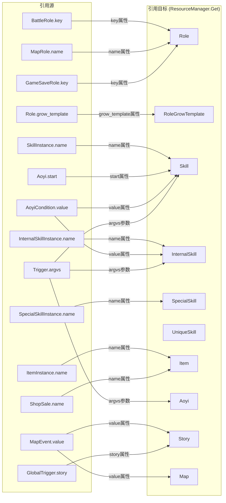
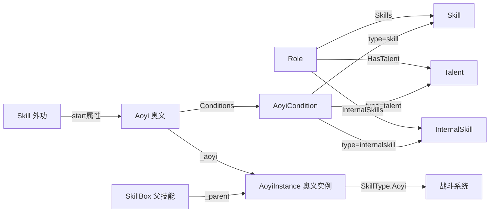
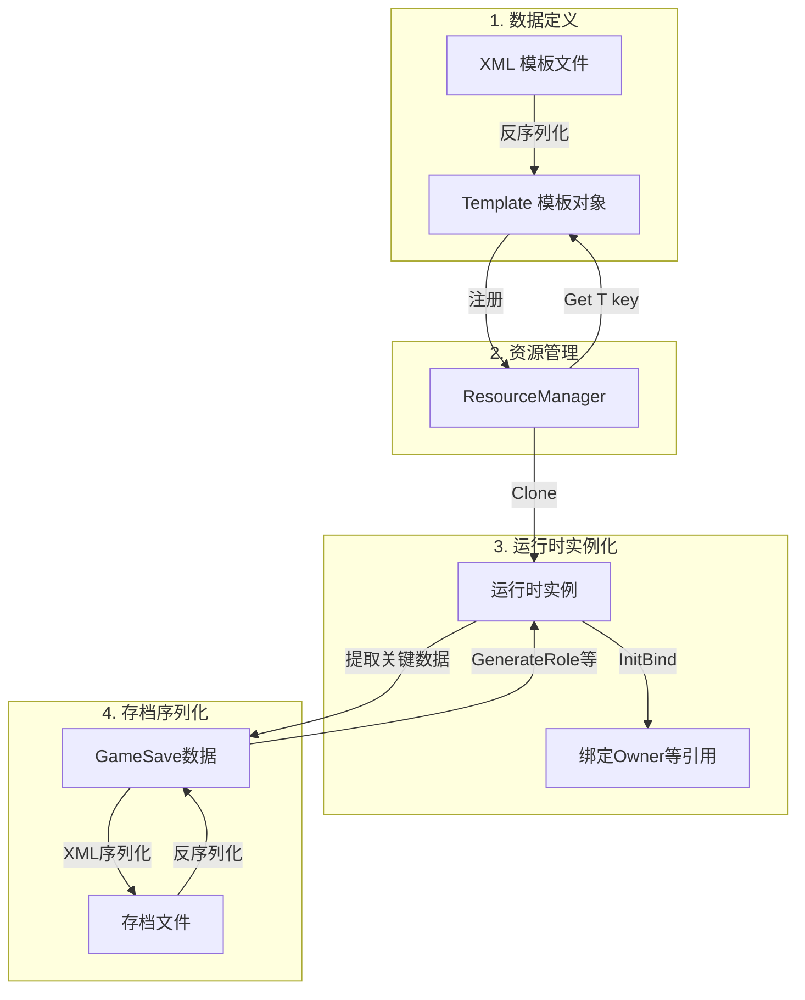

# 金庸群侠传X 模型引用关系文档

> 序列化文件路径: `gamedata/modcache/Template/Scripts/*.xml`  
> Model 类路径: `Assets/Scripts/Assembly-CSharp/JyGame/*.cs`

---

## 一、总览

系统包含 **三层模型**：

| 层级 | 说明 | 示例 |
|------|------|------|
| **模板层 (Template)** | XML 定义的游戏数据模板，通过 `ResourceManager.Get<T>(key)` 查找 | `Skill`, `Item`, `Role`, `Aoyi` |
| **实例层 (Instance)** | 运行时动态创建的包装对象，关联到具体角色 | `SkillInstance`, `ItemInstance`, `AoyiInstance` |
| **存档层 (Save)** | 序列化到存档文件的数据 | `GameSave`, `GameSaveRole`, `GameSaveItem` |

---

## 二、核心模型关系图

```mermaid
classDiagram
    direction TB

    %% ========== 基础类 ==========
    class BasePojo {
        <<abstract>>
        +string PK
        +InitBind()
    }

    class SkillBox {
        <<abstract>>
        +Role Owner
        +string Name
        +int Level
        +float Power
        +IEnumerable~Buff~ Buffs
    }

    %% ========== 角色相关 ==========
    class Role {
        +string Key
        +string Name
        +string GrowTemplateValue
        +List~SkillInstance~ Skills
        +List~InternalSkillInstance~ InternalSkills
        +List~SpecialSkillInstance~ SpecialSkills
        +List~ItemInstance~ Equipment
        +List~string~ Talents
        +int hp, maxhp, mp, maxmp
        +AttributeHelper Attributes
    }

    class RoleGrowTemplate {
        +string Name
        +AttributeHelper Attributes
        +int hp, mp, wuxing, bili...
    }

    class Menpai {
        +string Name
        +string Background
        +string shifu, zhuxiu, tedian
    }

    %% ========== 武学相关 ==========
    class Skill {
        +string Name
        +int Type
        +float BasePower
        +float Step
        +float Hard
        +float Suit
        +string buff
        +List~SkillLevelInfo~ Levels
        +List~Trigger~ Triggers
        +List~UniqueSkill~ UniqueSkills
    }

    class InternalSkill {
        +string Name
        +float Attack
        +float Defence
        +float Critical
        +List~Trigger~ Triggers
        +List~UniqueSkill~ UniqueSkills
    }

    class SpecialSkill {
        +string Name
        +int CostBall
        +int Cd
        +int CostMp
        +string buff
    }

    class UniqueSkill {
        +string Name
        +float PowerAdd
        +int RequireLevel
        +int CostBall
        +int CastSize
        +int CoverSize
        +int CoverType
        +string buff
    }

    class SkillLevelInfo {
        +int Level
        +float Power
        +int CoverSize
        +int CastSize
        +int CoverType
        +string Animation
        +int Cd
    }

    %% ========== 奥义相关 ==========
    class Aoyi {
        +string Name
        +string start
        +int level
        +float probability
        +float addPower
        +string buff
        +string animation
        +List~AoyiCondition~ Conditions
    }

    class AoyiCondition {
        +string type
        +string value
        +int levelValue
    }

    %% ========== 物品相关 ==========
    class Item {
        +string Name
        +int type
        +int level
        +int price
        +string talent
        +int Cooldown
        +List~Require~ Requires
        +List~Trigger~ Triggers
    }

    class ItemTrigger {
        +int MinLevel
        +int MaxLevel
        +List~ITTrigger~ Triggers
    }

    class Require {
        +string Name
        +string ArgvsString
    }

    class Trigger {
        +string Name
        +string ArgvsString
        +int Level
    }

    %% ========== 地图/战斗/剧情 ==========
    class Map {
        +string Name
        +string pic
        +List~Music~ Musics
        +List~MapLocation~ MapUnits
    }

    class MapLocation {
        +int x, y
        +string name
        +string pic
        +List~MapEvent~ Events
    }

    class MapRole {
        +string name
        +string pic
        +List~MapEvent~ Events
    }

    class MapEvent {
        +string type
        +string value
        +string image
        +List~Condition~ Conditions
    }

    class Battle {
        +string Key
        +string music
        +string mapkey
        +string must
        +List~BattleRole~ Roles
        +List~StoryAction~ StoryActions
    }

    class BattleRole {
        +string PredefinedKey
        +int Team
        +int X, Y
        +int Face
    }

    class Shop {
        +string Name
        +string pic
        +string music
        +List~ShopSale~ Sales
    }

    class ShopSale {
        +string name
        +int price
        +string limit
    }

    class Tower {
        +string Key
        +string desc
        +List~TowerMap~ Maps
        +List~Condition~ Conditions
    }

    class Story {
        +string Name
        +List~StoryAction~ Actions
        +List~StoryResult~ Results
    }

    class StoryAction {
        +string type
        +string value
    }

    class StoryResult {
        +string type
        +string ret
        +string value
    }

    class GlobalTrigger {
        +string story
        +List~Condition~ Conditions
    }

    class Condition {
        +string type
        +string value
        +int number
    }

    class Resource {
        +string Key
        +string Value
        +string Icon
    }

    class AnimationGroup {
        +List~AnimationImage~ images
    }

    %% ========== 实例层 ==========
    class SkillInstance {
        +string name
        +int level
        +int maxlevel
        +List~UniqueSkillInstance~ UniqueSkills
        +Skill Skill
    }

    class InternalSkillInstance {
        +string name
        +int level
        +int equipped
        +List~UniqueSkillInstance~ UniqueSkills
        +InternalSkill InternalSkill
    }

    class SpecialSkillInstance {
        +string name
        +SpecialSkill SpecialSkill
    }

    class UniqueSkillInstance {
        +UniqueSkill _skill
        +SkillBox _parent
    }

    class ItemInstance {
        +string Name
        +List~Trigger~ AdditionTriggers
        +Item item
    }

    class AoyiInstance {
        +SkillBox _parent
        +Aoyi _aoyi
    }

    class Buff {
        +string Name
        +int Level
        +int Round
        +float Property
    }

    %% ========== 存档层 ==========
    class GameSave {
        +GameSaveRole[] Roles
        +GameSaveRole[] Follows
        +GameSaveItem[] GameItems
        +GameSaveItem[] XiangziItems
        +GameSaveKeyValues[] KeyValues
    }

    class GameSaveRole {
        +string key
        +string grow_template
        +string talent
        +GameSaveRoleSkill[] skills
        +GameSaveRoleSkill[] internalSkills
        +GameSaveRoleSkill[] specialSkills
        +GameSaveItem[] equippments
    }

    class GameSaveRoleSkill {
        +string name
        +int level
        +int exp
        +int equipped
    }

    class GameSaveItem {
        +string name
        +int count
        +Trigger[] triggers
    }

    %% ========== 继承关系 ==========
    BasePojo <|-- Role
    BasePojo <|-- RoleGrowTemplate
    BasePojo <|-- Menpai
    BasePojo <|-- ItemInstance
    BasePojo <|-- GameSave
    BasePojo <|-- GameSaveRole
    BasePojo <|-- GameSaveItem
    BasePojo <|-- Skill
    BasePojo <|-- InternalSkill
    BasePojo <|-- SpecialSkill
    BasePojo <|-- Aoyi
    BasePojo <|-- Item
    BasePojo <|-- Map
    BasePojo <|-- Battle
    BasePojo <|-- Shop
    BasePojo <|-- Tower
    BasePojo <|-- Story
    BasePojo <|-- GlobalTrigger
    BasePojo <|-- Resource
    BasePojo <|-- AnimationGroup
    BasePojo <|-- ItemTrigger

    SkillBox <|-- SkillInstance
    SkillBox <|-- InternalSkillInstance
    SkillBox <|-- SpecialSkillInstance
    SkillBox <|-- UniqueSkillInstance
    SkillBox <|-- AoyiInstance

    MapRole <|-- MapLocation

    %% ========== 关联关系 ==========
    Role "1" --> "*" SkillInstance : Skills
    Role "1" --> "*" InternalSkillInstance : InternalSkills
    Role "1" --> "*" SpecialSkillInstance : SpecialSkills
    Role "1" --> "*" ItemInstance : Equipment
    Role "1" --> "1" RoleGrowTemplate : grow_template

    Skill "1" --> "*" Trigger : Triggers
    Skill "1" --> "*" UniqueSkill : UniqueSkills
    Skill "1" --> "*" SkillLevelInfo : Levels

    InternalSkill "1" --> "*" Trigger : Triggers
    InternalSkill "1" --> "*" UniqueSkill : UniqueSkills

    Aoyi "1" --> "*" AoyiCondition : Conditions
    Aoyi "1" --> "1" Skill : start

    Item "1" --> "*" Trigger : Triggers
    Item "1" --> "*" Require : Requires

    SkillInstance "1" --> "*" UniqueSkillInstance : UniqueSkills
    SkillInstance "1" --> "1" Skill : template
    SkillInstance "1" --> "1" Role : Owner

    InternalSkillInstance "1" --> "*" UniqueSkillInstance : UniqueSkills
    InternalSkillInstance "1" --> "1" InternalSkill : template
    InternalSkillInstance "1" --> "1" Role : Owner

    SpecialSkillInstance "1" --> "1" SpecialSkill : template
    SpecialSkillInstance "1" --> "1" Role : Owner

    UniqueSkillInstance "1" --> "1" UniqueSkill : template
    UniqueSkillInstance "1" --> "1" SkillBox : _parent

    ItemInstance "1" --> "1" Item : template

    AoyiInstance "1" --> "1" Aoyi : _aoyi
    AoyiInstance "1" --> "1" SkillBox : _parent

    Map "1" --> "*" MapLocation : MapUnits
    Map "1" --> "*" MapRole : MapUnits

    MapRole "1" --> "*" MapEvent : Events
    MapEvent "1" --> "*" Condition : Conditions

    Battle "1" --> "*" BattleRole : Roles
    BattleRole "1" --> "1" Role : PredefinedKey

    Shop "1" --> "*" ShopSale : Sales
    ShopSale "1" --> "1" Item : name

    Tower "1" --> "*" Condition : Conditions

    Story "1" --> "*" StoryAction : Actions
    Story "1" --> "*" StoryResult : Results

    GlobalTrigger "1" --> "*" Condition : Conditions
    GlobalTrigger "1" --> "1" Story : story

    GameSave "1" --> "*" GameSaveRole : Roles
    GameSave "1" --> "*" GameSaveItem : GameItems
    GameSaveRole "1" --> "*" GameSaveRoleSkill : skills
    GameSaveRole "1" --> "*" GameSaveItem : equippments
    GameSaveRole "1" --> "1" Role : key
    GameSaveRoleSkill "1" --> "1" Skill : name

    ItemTrigger "1" --> "*" ITTrigger : Triggers

    Buff ..> Skill : parsed from string
    Buff ..> InternalSkill : parsed from string
    Buff ..> UniqueSkill : parsed from string
    Buff ..> Aoyi : parsed from string
    Buff ..> SpecialSkill : parsed from string
```



---

## 三、XML 文件与 Model 映射

| XML 文件 | 根元素 | C# Model | XmlType |
|----------|--------|----------|---------|
| `roles.xml` | `<role>` | `Role` | `role` |
| `skills.xml` | `<skill>` | `Skill` | `skill` |
| `internal_skills.xml` | `<internal_skill>` | `InternalSkill` | `internal_skill` |
| `special_skills.xml` | `<special_skill>` | `SpecialSkill` | `special_skill` |
| `aoyis.xml` | `<aoyi>` | `Aoyi` | `aoyi` |
| `items.xml` | `<item>` | `Item` | `item` |
| `item_triggers.xml` | `<item_trigger>` | `ItemTrigger` | `item_trigger` |
| `maps.xml` | `<map>` | `Map` | `map` |
| `battles.xml` | `<battle>` | `Battle` | `battle` |
| `shops.xml` | `<shop>` | `Shop` | `shop` |
| `towers.xml` | `<tower>` | `Tower` | `tower` |
| `storys.xml` | `<story>` | `Story` | `story` |
| `globaltrigger.xml` | `<trigger>` | `GlobalTrigger` | `trigger` |
| `grow_templates.xml` | `<grow_template>` | `RoleGrowTemplate` | `grow_template` |
| `menpai.xml` | `<menpai>` | `Menpai` | `menpai` |
| `resource.xml` | `<resource>` | `Resource` | `resource` |
| `animations.xml` | `<animation>` | `AnimationGroup` | `animation` |

---

## 四、跨实体字符串引用

系统中大量使用 **字符串键名** 实现跨实体引用，通过 `ResourceManager.Get<T>(key)` 在运行时解析：



---

## 五、类继承体系

```mermaid
classDiagram
    direction TB

    class BasePojo {
        <<abstract>>
        +string PK
        +string Xml
        +InitBind()
        +Create~T~(string xml)
    }

    class SkillBox {
        <<abstract>>
        +Role Owner
        +string Name
        +int Level
        +float Power
        +SkillCoverType CoverType
        +SkillType SkillType
        +IEnumerable~Buff~ Buffs
        +TryAddExp(int exp)
    }

    %% 模板层 (Template Layer)
    class Role
    class Skill
    class InternalSkill
    class SpecialSkill
    class Aoyi
    class Item
    class Map
    class Battle
    class Shop
    class Tower
    class Story
    class GlobalTrigger
    class RoleGrowTemplate
    class Menpai
    class Resource
    class ItemTrigger
    class AnimationGroup

    %% 实例层 (Instance Layer)
    class SkillInstance {
        +Skill Skill
        +List~UniqueSkillInstance~ UniqueSkills
    }
    class InternalSkillInstance {
        +InternalSkill InternalSkill
        +List~UniqueSkillInstance~ UniqueSkills
    }
    class SpecialSkillInstance {
        +SpecialSkill SpecialSkill
    }
    class UniqueSkillInstance {
        +UniqueSkill UniqueSkill
        +SkillBox Parent
    }
    class ItemInstance {
        +Item Item
        +List~Trigger~ AdditionTriggers
    }
    class AoyiInstance {
        +Aoyi Aoyi
        +SkillBox Parent
    }

    %% 继承
    BasePojo <|-- Role
    BasePojo <|-- Skill
    BasePojo <|-- InternalSkill
    BasePojo <|-- SpecialSkill
    BasePojo <|-- Aoyi
    BasePojo <|-- Item
    BasePojo <|-- Map
    BasePojo <|-- Battle
    BasePojo <|-- Shop
    BasePojo <|-- Tower
    BasePojo <|-- Story
    BasePojo <|-- GlobalTrigger
    BasePojo <|-- RoleGrowTemplate
    BasePojo <|-- Menpai
    BasePojo <|-- Resource
    BasePojo <|-- ItemTrigger
    BasePojo <|-- AnimationGroup
    BasePojo <|-- ItemInstance

    SkillBox <|-- SkillInstance
    SkillBox <|-- InternalSkillInstance
    SkillBox <|-- SpecialSkillInstance
    SkillBox <|-- UniqueSkillInstance
    SkillBox <|-- AoyiInstance

    note for BasePojo "所有模板模型的基础类\n提供XML序列化和PK主键"
    note for SkillBox "所有技能实例的基础类\n关联到所属Role"
    note for ItemInstance "唯一同时继承BasePojo\n和充当实例包装的类"
```



---

## 六、关键引用关系详解

### 6.1 Role（角色）— 核心聚合根

`Role` 是整个系统的核心实体，聚合了角色的所有数据：

```
Role
├── Skills (List<SkillInstance>)          ──→ 外功武学列表
│   └── UniqueSkills (List<UniqueSkillInstance>)  ──→ 每门外功的绝技
├── InternalSkills (List<InternalSkillInstance>)   ──→ 内功列表
│   └── UniqueSkills (List<UniqueSkillInstance>)  ──→ 每门内功的绝技
├── SpecialSkills (List<SpecialSkillInstance>)     ──→ 特殊技能列表
├── Equipment (List<ItemInstance>)                ──→ 装备列表
├── Talents (List<string>)                        ──→ 天赋列表
└── GrowTemplate (RoleGrowTemplate)               ──→ 成长模板
```

**关键行为**：
- `InitBind()`: 将 Skills/InternalSkills/SpecialSkills 的 `Owner` 设为自身
- `GetTriggers(name)`: 遍历装备、技能、内功的所有触发器
- `HasTalent(name)`: 检查自身天赋 + 装备天赋 + 当前内功天赋

### 6.2 Skill 体系

```
Skill (外功模板)
├── Levels (SkillLevelInfo)  ── 按等级覆盖属性
├── Triggers (Trigger)       ── 触发效果
└── UniqueSkills (UniqueSkill) ── 绝技定义

InternalSkill (内功模板)
├── Triggers (Trigger)
└── UniqueSkills (UniqueSkill)

SpecialSkill (特技模板)
└── (独立技能，无子元素)

UniqueSkill (绝技模板)
└── 嵌入在 Skill/InternalSkill 中
```

运行时实例化：

```
SkillInstance ──wraps──→ Skill
  └── UniqueSkillInstance ──wraps──→ UniqueSkill

InternalSkillInstance ──wraps──→ InternalSkill
  └── UniqueSkillInstance ──wraps──→ UniqueSkill

SpecialSkillInstance ──wraps──→ SpecialSkill

AoyiInstance ──decorates──→ SkillBox + Aoyi
```

### 6.3 Trigger（触发器）系统

`Trigger` 是贯穿整个系统的通用机制，出现在：
- `Skill.Triggers`: 外功升级触发效果
- `InternalSkill.Triggers`: 内功升级触发效果
- `Item.Triggers`: 物品基础效果
- `ItemInstance.AdditionTriggers`: 物品随机附加效果

Trigger 的 `argvs` 参数常引用其他实体名（如 `powerup_skill` 引用技能名，`powerup_internalskill` 引用内功名，`powerup_aoyi` 引用奥义名）。

### 6.4 Condition（条件）系统

`Condition` 用于判断事件/触发器是否满足条件，出现在：
- `MapEvent.Conditions`: 地图事件触发条件
- `Tower.Conditions`: 挑战塔进入条件
- `GlobalTrigger.Conditions`: 全局剧情触发条件
- `Aoyi.Conditions` (AoyiCondition, 类似结构): 奥义发动条件

条件类型包括：`in_team`, `level_greater_than`, `should_finish`, `in_menpai`, `friendCount`, `exceed_day` 等，通过 `value` 字段引用目标实体。

### 6.5 地图/战斗/剧情关系

```
Map
├── MapUnits (List<MapLocation/MapRole>)
│   ├── MapRole ──name──→ Role
│   └── MapLocation (extends MapRole)
│       └── Events (List<MapEvent>)
│           ├── Conditions (进入条件)
│           └── value ──→ Map (跳转地图) 或 Story (触发剧情)
└── Musics (音乐资源)

Battle
├── Roles (List<BattleRole>)
│   └── BattleRole.key ──→ Role (预定义角色)
├── music ──→ 音乐资源
├── mapkey ──→ 战斗场景地图
└── StoryActions (战斗结束后的剧情动作)

Story
├── Actions (List<StoryAction>) ── 剧情步骤
└── Results (List<StoryResult>) ── 剧情分支结果

GlobalTrigger
├── Conditions ── 触发条件
└── story ──→ Story (条件满足后触发的剧情)

Tower
├── Maps (List<TowerMap>) ── 塔层地图
│   └── items (掉落物品列表)
└── Conditions ── 进入条件
```

### 6.6 存档体系

```
GameSave (单个存档文件)
├── Roles (GameSaveRole[])          ── 队伍角色
│   ├── skills (GameSaveRoleSkill[])     ──→ Skill.name
│   ├── internalSkills (GameSaveRoleSkill[]) ──→ InternalSkill.name
│   ├── specialSkills (GameSaveRoleSkill[])  ──→ SpecialSkill.name
│   └── equippments (GameSaveItem[])    ──→ Item.name
├── Follows (GameSaveRole[])        ── 跟随者
├── GameItems (GameSaveItem[])      ── 背包物品
├── XiangziItems (GameSaveItem[])   ── 箱子物品
└── KeyValues (GameSaveKeyValues[]) ── 键值对元数据

GlobalSave (全局存档)
├── Nicks (string[])                     ── 历史昵称
├── KeyValues (GameSaveKeyValues[])      ── 全局键值对
└── SkillMaxLevels (GlobalSkillMaxLevel[]) ── 跨存档技能上限
```

---

## 七、奥义（Aoyi）体系

奥义是一种特殊的战斗技能组合机制：



奥义发动条件：
1. 角色拥有指定的外功 (`start` 属性指向的 Skill)
2. 外功达到指定等级
3. 满足所有 `AoyiCondition` (拥有指定技能/内功/天赋)

---

## 八、数据流向概览



---

## 九、文件清单

### 模板 XML 文件

| 文件 | 大小 |
|------|------|
| `roles.xml` | ~335 KB |
| `skills.xml` | ~35 KB |
| `internal_skills.xml` | ~12 KB |
| `special_skills.xml` | ~3 KB |
| `aoyis.xml` | ~18 KB |
| `items.xml` | ~33 KB |
| `item_triggers.xml` | ~7 KB |
| `maps.xml` | ~53 KB |
| `battles.xml` | ~37 KB |
| `shops.xml` | ~32 KB |
| `towers.xml` | ~79 KB |
| `storys.xml` | ~127 KB |
| `storysCG.xml` | 单独文件 |
| `storysLudingji.xml` | 单独文件 |
| `storysPY.xml` | 单独文件 |
| `globaltrigger.xml` | ~5 KB |
| `grow_templates.xml` | ~3 KB |
| `menpai.xml` | ~6 KB |
| `resource.xml` | ~2 KB |
| `resource_suggesttips.xml` | 提示资源 |
| `animations.xml` | 动画配置 |
| `touch.xml` | 触屏配置 |
| `newbie.xml` | 新手引导 |

### C# Model 文件 (共 134 个 .cs 文件)

核心 Model 类（部分列表）：

| 类名 | 文件 | 说明 |
|------|------|------|
| `Role` | Role.cs | 角色（核心聚合根） |
| `Skill` | Skill.cs | 外功武学模板 |
| `InternalSkill` | InternalSkill.cs | 内功模板 |
| `SpecialSkill` | SpecialSkill.cs | 特殊技能模板 |
| `UniqueSkill` | Skill.cs (内嵌) | 绝技模板 |
| `Aoyi` | Aoyi.cs | 奥义模板 |
| `Item` | Item.cs | 物品模板 |
| `ItemTrigger` | ItemTrigger.cs | 物品随机触发配置 |
| `Map` | Map.cs | 地图 |
| `MapEvent` | MapEvent.cs | 地图事件 |
| `MapLocation` | MapLocation.cs | 地图地点 |
| `MapRole` | MapRole.cs | 地图角色 |
| `Battle` | Battle.cs | 战斗配置 |
| `BattleRole` | BattleRole.cs | 战斗角色 |
| `Shop` | Shop.cs | 商店 |
| `ShopSale` | ShopSale.cs | 商品 |
| `Tower` | Tower.cs | 挑战塔 |
| `Story` | Story.cs | 剧情 |
| `StoryAction` | StoryAction.cs | 剧情动作 |
| `StoryResult` | StoryResult.cs | 剧情结果 |
| `GlobalTrigger` | GlobalTrigger.cs | 全局触发器 |
| `Condition` | Condition.cs | 条件判断 |
| `Trigger` | Trigger.cs | 触发器 |
| `Require` | Require.cs | 需求条件 |
| `Buff` | Buff.cs | Buff效果 |
| `RoleGrowTemplate` | RoleGrowTemplate.cs | 成长模板 |
| `Menpai` | Menpai.cs | 门派 |
| `Resource` | Resource.cs | 资源定义 |
| `AnimationGroup` | AnimationGroup.cs | 动画组 |
| `SkillInstance` | SkillInstance.cs | 技能实例 |
| `InternalSkillInstance` | InternalSkillInstance.cs | 内功实例 |
| `SpecialSkillInstance` | SpecialSkillInstance.cs | 特技实例 |
| `UniqueSkillInstance` | (未单独文件) | 绝技实例 |
| `ItemInstance` | ItemInstance.cs | 物品实例 |
| `AoyiInstance` | AoyiInstance.cs | 奥义实例 |
| `SkillBox` | SkillBox.cs | 技能盒抽象基类 |
| `BasePojo` | BasePojo.cs | 数据对象基类 |
| `GameSave` | GameSave.cs | 游戏存档 |
| `GameSaveRole` | GameSaveRole.cs | 存档角色 |
| `GameSaveRoleSkill` | GameSaveRoleSkill.cs | 存档技能 |
| `GameSaveItem` | GameSaveItem.cs | 存档物品 |
| `GameSaveKeyValues` | GameSaveKeyValues.cs | 存档键值对 |
| `GlobalSave` | GlobalSave.cs | 全局存档 |
| `GlobalSkillMaxLevel` | GlobalSkillMaxLevel.cs | 全局技能上限 |
| `GlobalData` | GlobalData.cs | 全局运行时数据 |
| `ModData` | ModData.cs | Mod数据 |
| `CommonSettings` | CommonSettings.cs | 通用配置 |
| `Configer` | Configer.cs | 配置开关 |
| `BattleField` | BattleField.cs | 战斗场景控制器 |

按依赖关系从零到整，分批推进：

### 第一批（零依赖，纯数据）

直接写，不引用任何其他 Model：

```
RoleGrowTemplate    ← 纯 int 属性，最简单的起点
Menpai              ← 纯 string 属性  
Require             ← name + argvs 两个字段
Condition           ← type + value + number
AoyiCondition       ← type + value + levelValue
SkillLevelInfo      ← level + power + coverSize 等数值
Trigger             ← name + argvs + lv
Buff                ← name + level + round + property
Resource            ← key + value + icon
```

### 第二批（引用第一批）

```
ItemTrigger         ← List<ITTrigger>（可先跳过，不是核心）
UniqueSkill         ← 引 Trigger 模式，有 Buff（字符串解析）
Item                ← List<Require> + List<Trigger>
Skill               ← List<Trigger> + List<UniqueSkill> + List<SkillLevelInfo>
InternalSkill       ← List<Trigger> + List<UniqueSkill>
SpecialSkill        ← 独立，Buff 字符串
Aoyi                ← List<AoyiCondition>
ShopSale            ← 纯属性，name 是 Item 的字符串引用
MapEvent            ← List<Condition>
StoryAction         ← type + value 纯属性
StoryResult         ← type + ret + value 纯属性
```

### 第三批（引用第二批）

```
Shop                ← List<ShopSale>
MapRole             ← List<MapEvent>
MapLocation          ← : MapRole（继承 + x, y 坐标）
Map                 ← List<MapLocation> + List<MapRole>
Story               ← List<StoryAction> + List<StoryResult>
Tower               ← List<Condition> + List<TowerMap>（TowerMap 可内嵌）
GlobalTrigger       ← List<Condition>
BattleRole          ← 纯属性，key 是 Role 的字符串引用
```

### 第四批（引用第三批 + 聚合）

```
Battle              ← List<BattleRole> + List<StoryAction>
Role                ← 最终聚合根，引用所有子结构
```

`Role` 放最后，因为它聚合一堆内容。建议在 Role 内部定义轻量的内嵌类型替代原来的 Instance 类：

```csharp
// 嵌入 Role 内部的轻量结构，替代 SkillInstance / InternalSkillInstance
[Serializable]
public class RoleSkillEntry
{
    [JsonProperty("name")]    public string Name;
    [JsonProperty("level")]   public int Level;
    [JsonProperty("maxLevel")]public int MaxLevel;
    // InternalSkill 专用
    [JsonProperty("equipped")]public int Equipped;
}
```

---

### 建议的实际执行路径

```
1. RoleGrowTemplate  ← 先写一个最简的，验证 JSON 读写 + 编辑器流程
2. Item              ← 第一个有子集合的，验证 TableList 编辑 List<Require/Trigger>
3. Skill             ← 第一个有嵌套类型的 (UniqueSkill)
4. Role              ← 最终聚合，验证所有模式集成

中间其他的（Map/Story/Battle 等）按需穿插，模式打通后就是体力活。
```

要我从 `RoleGrowTemplate` 开始帮你写第一个 Model 示例吗？